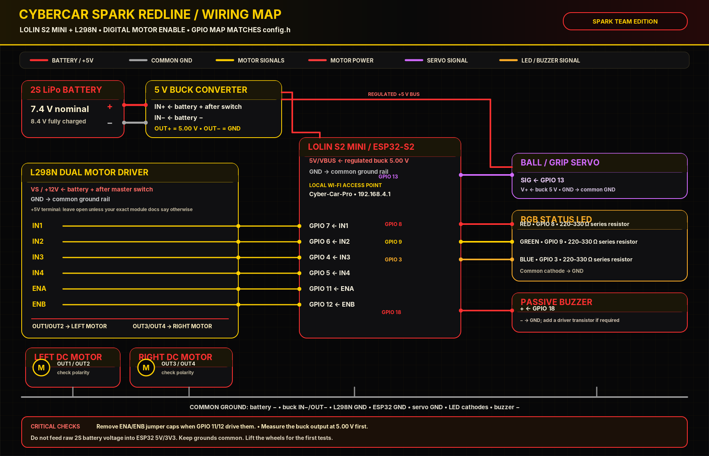

# SPARK REDLINE wiring guide

The carrier design is in [`hardware/CyberCar_SPARK_Redline_Carrier/`](hardware/CyberCar_SPARK_Redline_Carrier/). Open the KiCad `.kicad_pcb` file, and review `FABRICATION_AND_REVIEW.md` before manufacturing.

## ESP32-S2 to L298N

| LOLIN S2 Mini GPIO | L298N module pin | Carrier connection |
|---:|---|---|
| GPIO 7 | IN1 | J2 pin 4 → J3 pin 2 |
| GPIO 6 | IN2 | J2 pin 5 → J3 pin 3 |
| GPIO 4 | IN3 | J2 pin 6 → J3 pin 4 |
| GPIO 5 | IN4 | J2 pin 7 → J3 pin 5 |
| GPIO 11 | ENA | J2 pin 8 → J3 pin 6 |
| GPIO 12 | ENB | J2 pin 9 → J3 pin 7 |
| GND | GND | J2 pin 1 and J3 pin 1 common ground |

Remove ENA/ENB jumper caps on the L298N if GPIOs drive its enable inputs. Verify the left/right motor mapping on the physical chassis.

## Power

- Battery 2S LiPo: wire the motor-supply input of the L298N directly using appropriately rated leads/connectors.
- A separate branch feeds the buck converter input. Adjust its output and verify **5.00 V** with a multimeter.
- Connect buck output to carrier J1 (pin 1 +5V, pin 2 GND). The 5V pin then goes to the ESP32 5V input and servo power rail.
- Do not put raw 2S battery voltage onto the carrier J1 or ESP32 5V pin.
- Make all grounds common: battery negative, buck negative, L298N GND, ESP32 GND, carrier GND and servo GND.
- Do not connect carrier +5 V to the L298N module's +5 V terminal unless the exact module manual specifies it.
- Do not power the ESP32 at once from carrier 5 V and USB unless power isolation is confirmed for the exact board.

## Accessories

- J4: servo, pins GND / +5V / signal. Verify the actual servo pin order and size the buck for peak current.
- J5: future module, 3V3 / GND / GPIO1 / GPIO2. Low-current 3.3 V logic only.
- J6: passive piezo buzzer, +5V and transistor-switched return.
- D1–D3 are on-board status LEDs with R3–R5 current-limit resistors.

There is no sensor-specific sensing module in this firmware/carrier. Choose and document a replacement only after confirming its supply, interface voltage, pinout, power budget and failure mode.
