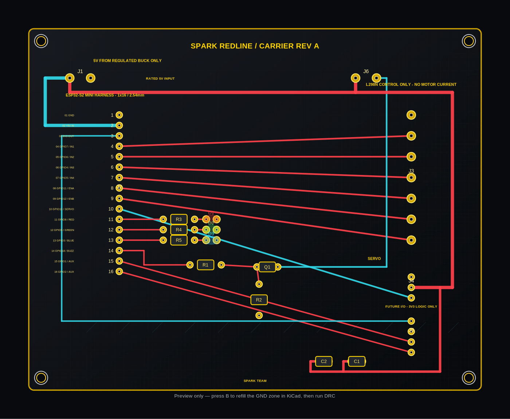

# CyberCar SPARK REDLINE Carrier PCB — Revision A

**Board class:** two-layer, low-current carrier / interconnect PCB. It is not an integrated ESP32 board, not an L298N H-bridge and not a battery charger. The ESP32-S2, L298N motor-driver module and buck converter remain separate modules connected through headers/wires.

> **Fabrication status: ENGINEERING DRAFT.** The PCB has not been checked with KiCad's native DRC or physically validated in this environment. Do not treat the preview as a manufacturing approval. Review footprints, copper zones, clearances, nets, part pinouts and power paths before plotting Gerbers.

## Files

| File | Use |
|---|---|
| `CyberCar_SPARK_Redline_Carrier.kicad_pcb` | Editable KiCad PCB board source. |
| `CyberCar_SPARK_Redline_Carrier.kicad_pro` | KiCad project settings. |
| `pcb_layout_preview.png` / `.svg` | Annotated visual preview; not a substitute for PCB Editor. |
| `carrier_system_schematic.png` / `.svg` | System wiring explanation, not a native KiCad schematic. |
| `BOM.csv` | Proposed bill of materials. Check actual component datasheets/vendor footprints before ordering. |
| `CONNECTOR_PINOUT.csv` | Connector/pinout source of truth to keep aligned with firmware. |
| `FABRICATION_AND_REVIEW.md` | DRC, electrical, mechanical and manufacturing checklist. |

## Concept and architecture

- Approximate outline: 110 × 88 mm (verify the Edge.Cuts layer in KiCad).
- Two copper layers; nominal 1.6 mm FR-4 assumed.
- Four M3 mounting holes.
- Carrier J1 takes **regulated +5.00 V only** from the buck converter.
- J2 is a 1×16 harness for the LOLIN S2 Mini signals and power.
- J3 is a 1×7 L298N control harness: GND, IN1–IN4, ENA, ENB. It carries logic/control signals only; motor current does not pass through this board.
- J4 is GND/+5 V/servo signal.
- J5 is a 3.3 V/GND/GPIO1/GPIO2 low-current expansion header for a future compatible peripheral.
- J6 is the passive buzzer connector; Q1 drives the low side.
- D1–D3/R3–R5 are status LED channels; C1 and C2 provide accessory-rail buffering/decoupling.

No distance sensor is placed on the carrier or used by this firmware. J5 is generic and is not preconfigured for any specific future sensor.

## Connector/power notes

1. Do not feed battery voltage into J1. It is not a raw battery connector.
2. Route 2S LiPo motor power directly to the L298N's motor supply with appropriately rated wiring/protection. Keep motor stall current off this carrier PCB.
3. Maintain common ground across the battery negative, buck converter, ESP32, carrier, L298N and servo.
4. Remove ENA/ENB jumper caps from the L298N module when GPIO11/GPIO12 drive enable pins. Module implementations differ; inspect the actual board.
5. Leave the L298N module's +5V terminal disconnected from carrier +5V unless the exact module documentation instructs otherwise.
6. Avoid simultaneous USB and carrier power until power-path/backfeed behavior for the actual LOLIN board has been checked.
7. Check the servo's peak/stall current against the buck converter. A servo can cause voltage dips or ESP32 resets if the supply is undersized.
8. J5/GPIOs are 3.3 V only. Add level shifting and power conditioning as required by any future add-on.

## Review in KiCad

1. Open `CyberCar_SPARK_Redline_Carrier.kicad_pro` (or the `.kicad_pcb` board) in KiCad PCB Editor.
2. Press **B** to refill the copper zones.
3. Run **Inspect → Design Rules Checker**. Review and resolve all unconnected pads, clearance errors, board-edge issues, silkscreen overlaps and unconnected copper islands.
4. Inspect F.Cu and B.Cu separately, compare every route to the nets/pads, and view the PCB in 3D.
5. Verify the vendor footprints for terminal blocks, pin headers, resistors, LEDs, transistor and capacitors.
6. Check Q1's actual base/collector/emitter order against its datasheet; TO-92 pin order varies by part/vendor.
7. Check C1 polarity, voltage rating and pitch; check servo signal/GND/+5 V order against the servo data sheet.
8. Verify mounting-hole locations against the real chassis and component clearances against the installed modules.
9. Confirm track widths, clearances and copper requirements with your board manufacturer.
10. With power absent, measure continuity and ensure no short between +5 V and GND. First power on from a current-limited 5 V bench supply if available.
11. Only after all checks pass should you plot Gerber and drill files. Review those plotted files in an independent Gerber viewer before ordering.

## Limits / excluded circuits

This board does not include a charger/BMS, fuse, reverse-polarity protection, motor current measurement, voltage monitoring, overcurrent shutdown, power MOSFET or a safety-rated emergency disconnect. It does not route L298N motor outputs. These functions require a separate validated design and appropriate component sizing.

See the project root `README.md`, `WIRING.md`, `LICENSE-HARDWARE-NOTICE.md` and `FABRICATION_AND_REVIEW.md` for the full system context.
